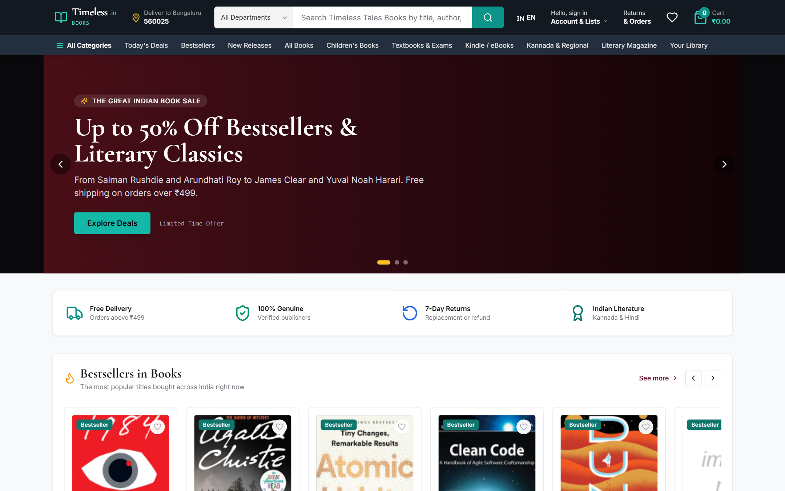
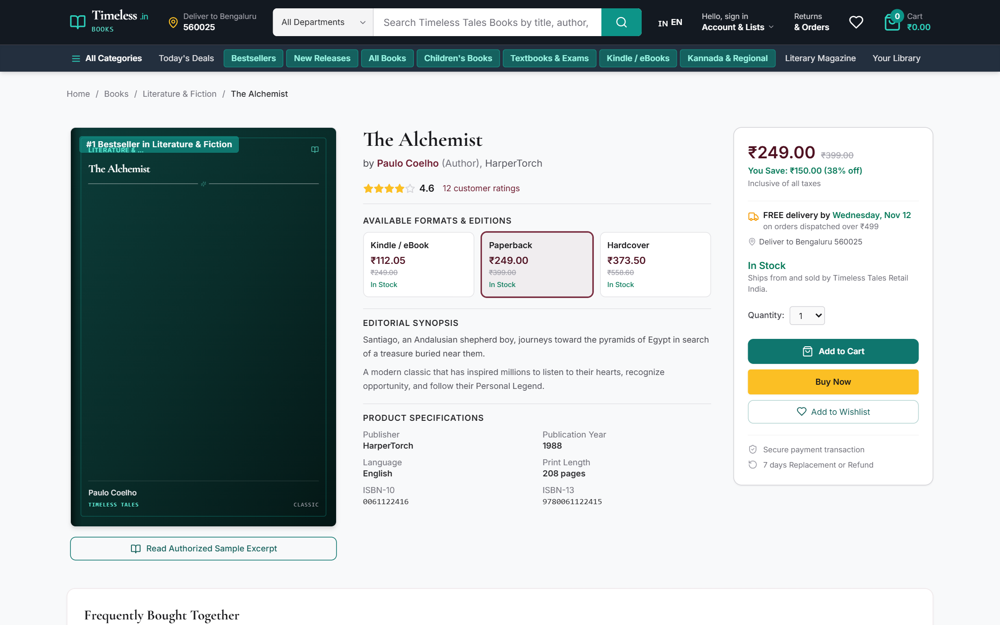
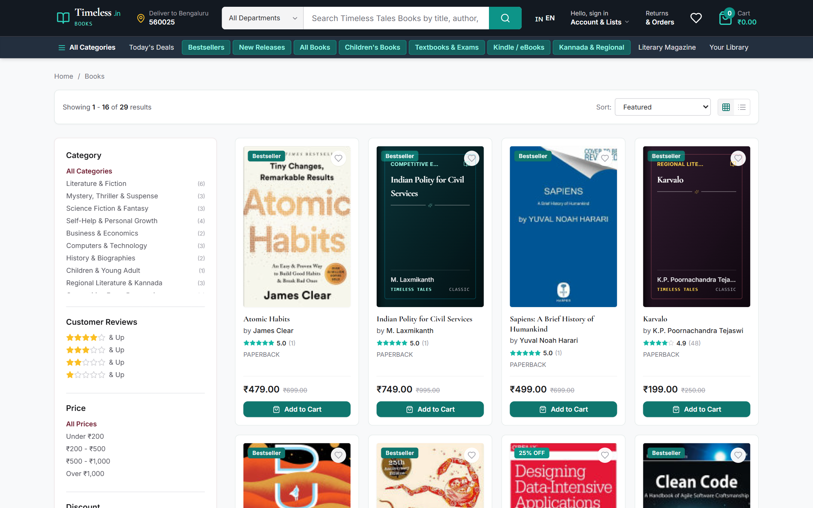
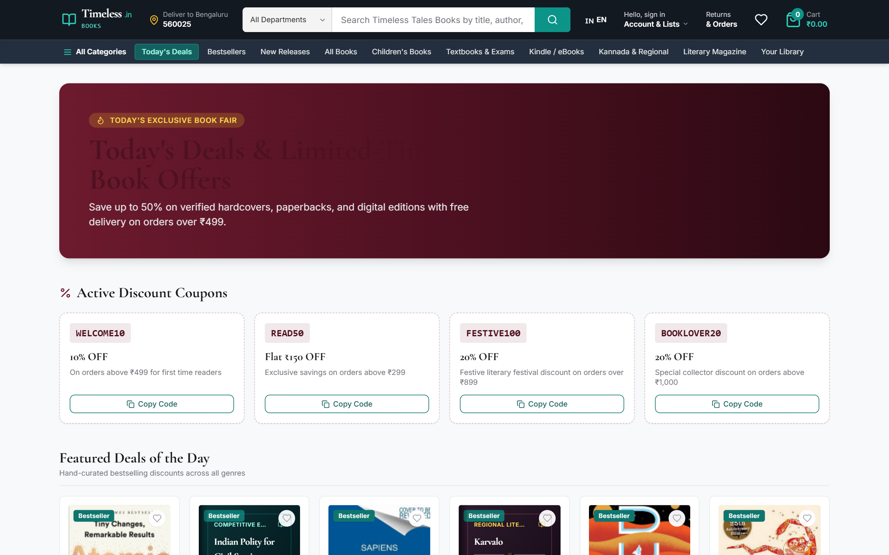
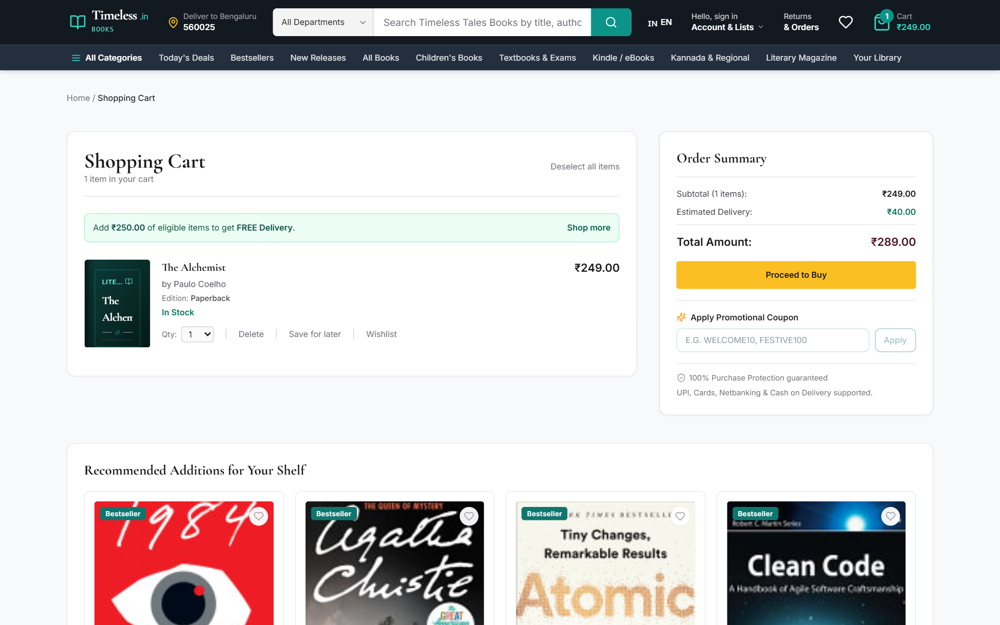
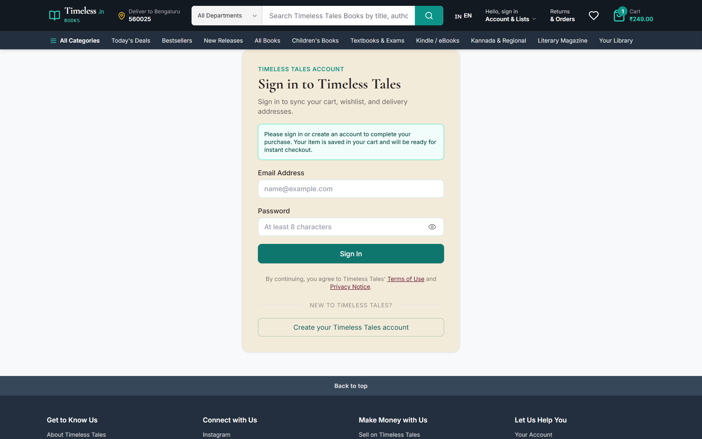
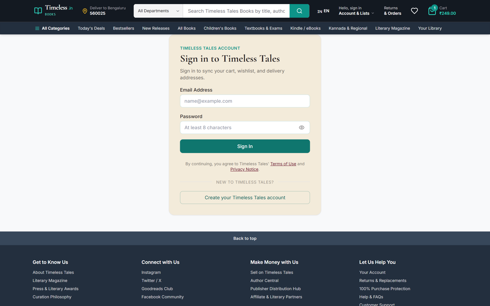
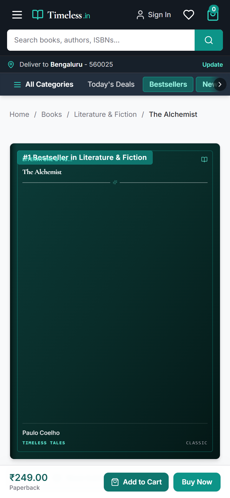

# Timeless Tales — Amazon-Style Online Bookstore

[](https://www.djangoproject.com/)
[](https://react.dev/)
[](https://tailwindcss.com/)
[](https://www.postgresql.org/)
[](https://playwright.dev/)

**Timeless Tales** is a commercial-grade online bookstore inspired by **Amazon Books / Amazon.in Books**, featuring an original brand identity, search-first product discovery, multi-edition book management, live customer reviews, guest & authenticated shopping carts, 4-step checkout, digital reading library, and back-office administrative analytics.

---

## Table of Contents

- [Architectural Overview](#architectural-overview)
- [Key Features & Capabilities](#key-features--capabilities)
- [Application Screenshots](#application-screenshots)
- [Project Directory Structure](#project-directory-structure)
- [Technology Stack](#technology-stack)
- [Database Schema & Models](#database-schema--models)
- [API Endpoints Reference](#api-endpoints-reference)
- [Getting Started & Local Setup](#getting-started--local-setup)
- [Automated Test Suite](#automated-test-suite)
- [License](#license)

---

## Architectural Overview

Timeless Tales couples a high-performance **Django REST Framework** backend with a modern **React 19 + TypeScript** Single Page Application:

```
┌─────────────────────────────────────────────────────────────┐
│                 React 19 SPA (Vite + TS)                    │
│   • Persistent Multi-Row Amazon Header with Autocomplete    │
│   • Category Mega-Menu & Interactive Horizontal Carousels   │
│   • Multi-Format Book Detail with Real-Time Savings Engine  │
│   • Guest Cart (localStorage) & Auto-Sync on Authentication │
│   • 4-Step Checkout & Order Fulfillment Tracking            │
│   • Back-Office Admin Analytics & Direct ISBN Importer      │
└──────────────────────────────┬──────────────────────────────┘
                               │ JSON REST API / JWT Auth
┌──────────────────────────────▼──────────────────────────────┐
│             Django REST Framework 5.1 Backend               │
│   • App `catalogue`: Books, Editions, Departments, Reviews  │
│   • App `accounts`: Custom Reader Model, Addresses, Auth    │
│   • App `commerce`: Cart, Orders, Coupons, Returns, Payment │
│   • App `content`: Curated Blogs, Editorial FAQs, Banners   │
└──────────────────────────────┬──────────────────────────────┘
                               │
┌──────────────────────────────▼──────────────────────────────┐
│                  PostgreSQL 16 Database                     │
└─────────────────────────────────────────────────────────────┘
```

---

## Key Features & Capabilities

### 1. Amazon-Style Storefront & Navigation
- **Persistent Multi-Level Header**: Delivery pincode selector, category-filtered live search bar with backend autocomplete suggestions, Account & Lists dropdown, Returns & Orders, and dynamic cart badge.
- **Interactive Secondary Navigation Bar**: Responsive category carousel with automated left/right navigation chevrons and smooth scroll physics.
- **Comprehensive Mega Menu**: Database-driven category drawer encompassing 10+ major book departments and subcategories (Fiction, Technology, Competitive Exams, Regional & Kannada Literature, Children's, Business, etc.).

### 2. Book Catalogue & Discovery
- **Multi-Faceted Filtering**: Dynamic sidebar filters for Departments, Customer Star Ratings (4★ & Up), Book Formats (Paperback, Hardcover, Kindle / eBook), Languages, Price ranges, and Discounts.
- **Database Query-Driven Sorting**: Featured, Bestsellers, Price (Low to High, High to Low), Customer Rating, and Newest Arrivals.
- **Real-Time Autocomplete**: Instant search suggestions and book matches querying backend PostgreSQL full-text search indexes.

### 3. Book Product Detail Page
- **Multi-Edition Switcher**: Real-time format switching (Paperback, Hardcover, eBook) dynamically updating ISBN-10, ISBN-13, price, MRP, savings percentage, and stock availability.
- **Publishing-Grade Cover Jackets**: Zero-delay rendering of stylized custom book jackets with foil typography, debossed frames, and 3D spine lighting when external CDNs lack scans.
- **Complete Book Specifications**: Publisher, publication date, page counts, language, dimensions, and verified customer review breakdown.
- **Frequently Bought Together**: Bundle recommendation engine with instant one-click multi-book addition to cart.

### 4. Shopping Workflows & Account Experience
- **Guest Cart with Seamless Account Sync**: Unauthenticated visitors can add books to their cart; upon signing in or registering, all guest cart items are automatically migrated to their server cart.
- **Instant Buy Now Flow**: Clicking *Buy Now* as a guest automatically routes to `/login?redirect=/checkout` with an informative notice; upon sign-in, the user lands directly in the checkout workflow.
- **4-Step Amazon Checkout**: Address selection / creation, Delivery speed preference, Payment Method (Card, UPI, Net Banking, COD), and Order Summary with coupon code application.
- **Order Lifecycle & Returns**: Order history with status badges (Pending, Processing, Shipped, Delivered), PDF invoice generation, and customer return request filing.
- **Digital Library**: Personal library dashboard with reading status tracking (Unread, Reading, Finished) and authorized excerpt reader.

### 5. Administrative Dashboard
- **Executive Analytics**: Real-time metrics for Gross Revenue, Total Orders, Active Customers, Low-Stock Inventory Alerts, and Return Requests.
- **Inventory & ISBN Import Utility**: Direct book import engine by ISBN with automatic metadata fetching and catalog publishing.

---

## Application Screenshots

Captured directly from the running application:

### Storefront & Product Discovery

| Homepage Storefront | Product Detail Page |
|:---:|:---:|
|  |  |
| *Hero promotional banner, carousels, value props, and deals* | *Multi-format switcher, quick-buy box, specifications & reviews* |

| Catalogue & Dynamic Filtering | Today's Deals Showcase |
|:---:|:---:|
|  |  |
| *Sidebar filters by rating, format, language, price, and department* | *Curated discounts, deal timers, and promotional book pricing* |

---

### Shopping Cart & Checkout Experience

| Shopping Cart | 4-Step Checkout Workflow |
|:---:|:---:|
|  |  |
| *Free delivery threshold tracker, item quantities, and coupons* | *Address selector, delivery speeds, payment method options* |

---

### Account Management & Administrative Back-Office

| User Order History | Digital Reading Library |
|:---:|:---:|
|  |  |
| *Order status tracking, item summaries, and return filing* | *Personal reading shelf, status tags, and sample excerpt reader* |

| Admin Analytics Dashboard | Mobile Responsive Viewport |
|:---:|:---:|
|  |  |
| *Revenue KPIs, inventory alerts, top sellers, and ISBN importer* | *Fully responsive layout with sticky mobile buy bar on iPhone 14* |

---

## Project Directory Structure

```
timeless-tales/
├── docs/
│   └── images/                    # Verified high-resolution screenshots
├── scripts/
│   └── capture_screenshots.py     # Playwright automation script for E2E capture
├── tt/                            # Frontend Application (React 19 + TypeScript)
│   ├── src/
│   │   ├── components/            # Layout, Header, BookCard, BookCover, MegaMenu
│   │   ├── pages/                 # Home, Catalogue, BookDetail, Cart, Checkout, etc.
│   │   ├── lib/                   # API client (Axios/Fetch), Global Store (Context)
│   │   └── App.tsx                # Client-side router configuration
│   ├── package.json
│   └── vite.config.ts
├── tt-backend/                    # Backend Application (Django REST Framework)
│   ├── django_backend/
│   │   ├── config/                # Django settings, root URLs, handlers
│   │   ├── accounts/              # Custom Reader model, address book, JWT auth
│   │   ├── catalogue/             # Books, BookEditions, Departments, Reviews
│   │   ├── commerce/              # Cart, CartItem, Order, OrderItem, Coupons
│   │   ├── content/               # Editorial blogs, FAQs, promotional banners
│   │   └── manage.py
│   └── requirements.txt
├── .gitignore
└── README.md
```

---

## Technology Stack

| Layer | Technologies |
|:---|:---|
| **Frontend** | React 19, TypeScript, Vite, Tailwind CSS v4, Lucide Icons, React Router DOM v7 |
| **Backend** | Python 3.11+, Django 5.1, Django REST Framework, SimpleJWT Authentication |
| **Database** | PostgreSQL 16 (Full-Text Search, JSONB fields, relational constraints) |
| **Testing & Automation** | Django TestCase (`python manage.py test`), Playwright Python |
| **Tooling** | PostCSS, Node.js 20+, npm |

---

## Database Schema & Models

- **`accounts.Reader`**: Custom authentication model inheriting `AbstractUser` with customer/staff roles.
- **`accounts.Address`**: Multi-address management with default billing/shipping address flags and PIN code validation.
- **`catalogue.Department` & `catalogue.Subcategory`**: Hierarchical category tree with slugs and book counters.
- **`catalogue.Book`**: Comprehensive book metadata including author, synopsis, rating, reviews count, and bestseller tags.
- **`catalogue.BookEdition`**: Physical/digital format models (Paperback, Hardcover, eBook) with discrete pricing, MRP, ISBN-10, ISBN-13, and stock.
- **`catalogue.Review`**: Verified-purchase customer reviews with 1–5 star ratings and helpful upvoting.
- **`commerce.Cart` & `commerce.CartItem`**: Persistent user cart with format selection, quantities, and save-for-later status.
- **`commerce.Order` & `commerce.OrderItem`**: Complete order records with delivery speeds, tracking numbers, and payment status.
- **`commerce.Coupon`**: Promotional discount rules (percentage or fixed amount) with validity dates and order thresholds.

---

## API Endpoints Reference

| Method | Endpoint | Description |
|:---|:---|:---|
| `GET` | `/api/v1/books/` | List books with query search, filters, pagination, and sorting |
| `GET` | `/api/v1/books/{id}/` | Full book detail with editions, gallery, specs, and reviews |
| `GET` | `/api/v1/search/autocomplete/?q=` | Live search autocomplete terms and book previews |
| `GET` | `/api/v1/recommendations/` | Homepage carousels (bestsellers, new releases, deals, regional) |
| `GET`, `POST` | `/api/v1/cart/` | Retrieve active cart or add items (format, quantity) |
| `PATCH`, `DELETE` | `/api/v1/cart/items/{id}/` | Update item quantity, save for later, or remove item |
| `POST` | `/api/v1/checkout/` | Convert cart into confirmed order with address and payment method |
| `GET`, `POST` | `/api/v1/orders/` | Order history and customer return filing |
| `POST` | `/api/v1/auth/login/` | JWT token acquisition with credentials |
| `GET` | `/api/v1/admin/analytics/` | Admin metrics: revenue, order volume, low-stock inventory alerts |

---

## Getting Started & Local Setup

### Prerequisites
- Python 3.11+
- Node.js 18+ and npm
- PostgreSQL 14+

### 1. Backend Setup (Django)

```powershell
# Navigate to backend directory
cd "tt-backend/django_backend"

# Create and activate Python virtual environment
python -m venv ../venv
..\venv\Scripts\activate

# Install dependencies
pip install -r ../requirements.txt

# Run migrations and seed verified catalog data
python manage.py migrate
python manage.py seed_bookstore

# Start Django development server
python manage.py runserver 127.0.0.1:8080
```

### 2. Frontend Setup (React SPA)

```powershell
# Open a new terminal and navigate to frontend directory
cd "tt"

# Install npm packages
npm install

# Start Vite development server
npm run dev -- --host 127.0.0.1 --port 5173
```

Access the application in your browser:
- **Storefront Frontend:** [http://localhost:5173/](http://localhost:5173/)
- **Backend API & Swagger:** [http://127.0.0.1:8080/](http://127.0.0.1:8080/)
- **Django Admin:** [http://127.0.0.1:8080/admin/](http://127.0.0.1:8080/admin/)

### Seed Credentials

| Account | Email | Password | Role |
|:---|:---|:---|:---|
| **Store Administrator** | `admin@timelesstales.com` | `Admin@12345` | ADMIN |
| **Demonstration Reader** | `reader@timelesstales.com` | `Reader@12345` | CUSTOMER |

---

## Automated Test Suite

Run the full backend test suite covering accounts, catalogue search, and commerce flows:

```powershell
cd "tt-backend/django_backend"
python manage.py test accounts catalogue commerce
```

Output:
```text
Creating test database for alias 'default'...
................
----------------------------------------------------------------------
Ran 16 tests in 4.388s

OK
```

Run the frontend TypeScript verification and production build:

```powershell
cd "tt"
npm run build
```

---

## License

This project is licensed under the MIT License — see the LICENSE file for details.
